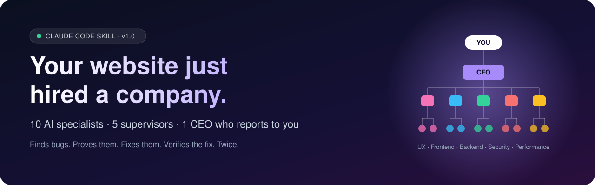
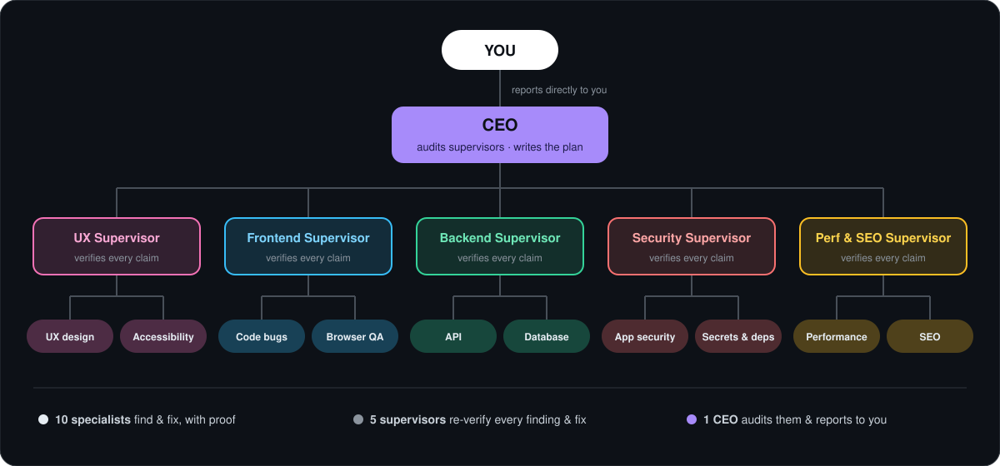
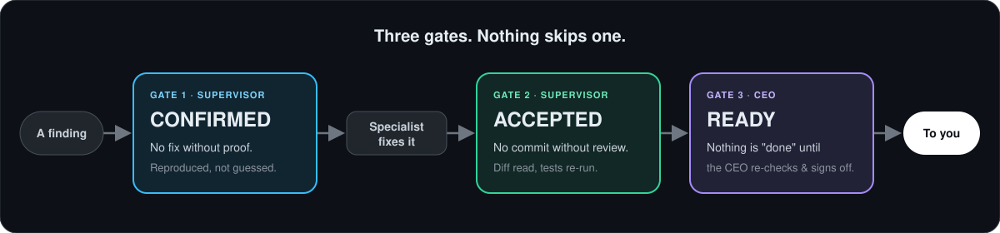
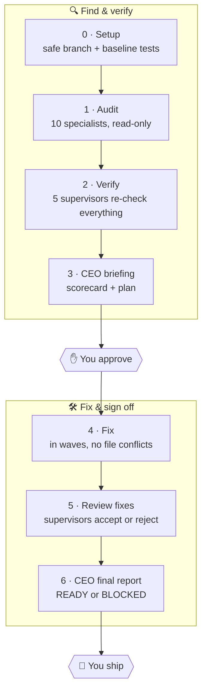

<p align="center">
  
</p>

<p align="center">
  
  
  
  
</p>

<h3 align="center">Stop getting 200 "possible issues" from an AI reviewer.<br>Get a team that <i>proves</i> every bug, fixes it, and checks the fix, twice.</h3>

---

## 🤯 The problem with AI code reviews

You ask an AI to "check my website" and get a wall of maybes: half of them false alarms, the other half "fixed" in ways that quietly break something else. You end up reviewing the reviewer.

**AI Website Audit Team works like a real company instead.** Ten specialists hunt for problems, and every claim needs proof. Five supervisors re-verify every finding and every fix. A CEO audits the supervisors and reports to **you** in plain English, with nothing marked "done" until it has passed every level.

<p align="center">
  
</p>

## ⚡ What makes it different

| | Typical AI review | **AI Website Audit Team** |
|---|---|---|
| Findings | Guesses and pattern matches | Each one comes with **proof**: code, command output or a reproduction |
| False alarms | You sort them out | **Supervisors reject them** before you ever see them |
| Fixes | Written and trusted blindly | A supervisor reads the diff and re-runs the tests before any **commit** |
| Who checks the checkers? | Nobody | **The CEO spot-checks the supervisors** and rates them |
| Report | 40 pages of jargon | A **plain-language briefing**: scorecard, top risks, decisions you need to make |
| Your code | Edited in place | Its **own git branch**, one commit per team, every fix revertible |

<p align="center">
  
</p>

## 🏢 Meet the team

| Team | Specialist #1 | Specialist #2 | Their supervisor is strict about… |
|---|---|---|---|
| 🎨 **UX** | **UX designer:** layout, broken states, forms, mobile | **Accessibility:** WCAG 2.2 AA, keyboard, contrast, screen readers | real user impact, not taste |
| 🖥️ **Frontend** | **Code bug hunter:** state, async, crashes, build errors | **Browser QA:** clicks through every route and flow like a real user | reproducible steps |
| 🗄️ **Backend** | **API auditor:** validation, errors, auth flows, webhooks | **Data layer:** schema, N+1 queries, transactions, data leaks | tracing the real request path |
| 🔐 **Security** | **AppSec:** OWASP Top 10, IDOR, XSS, injection, CSRF | **Secrets & supply chain:** leaked keys, CVEs, headers, CI | proven exploitability, not scary patterns |
| 🚀 **Perf & SEO** | **Performance:** bundle size, images, Core Web Vitals | **SEO:** indexability, meta, sitemap, structured data | measurements, not vibes |

And above them all:

> 👔 **The CEO** re-checks a sample of every supervisor's verdicts (including the rejections, because that's where real bugs hide), merges the five teams' results into one prioritised plan, and is the only one who reports to you.

## 🔄 How a run works



**Nothing is edited until you approve the plan, and nothing is pushed or deployed. Ever.**

## 📋 What lands on your desk

The CEO writes for you, not for engineers. Here's an **illustrative excerpt** of a briefing:

> ### Bottom line
> The site works for most visitors, but **anyone who is logged in can read other customers' orders** by changing a number in the URL. That's the top priority. Checkout also double-charges when the button is clicked twice.
>
> | Area | Status | Why |
> |---|---|---|
> | Security | 🔴 At risk | Order pages don't check who owns the order (SEC-002 = API-005) |
> | Frontend | 🟠 Needs work | Double-submit on checkout; crash when the cart is empty |
> | Performance | 🟠 Needs work | 2.1 MB hero image; LCP 4.8s on mobile |
> | SEO | 🟢 Good | Minor: 3 pages share one title |
>
> ### Decisions I need from you
> 1. A Stripe test key is committed in `config.js`. **Rotate it in Stripe** (we can remove it from the code, but only you can revoke it).
> 2. Should logged-out users see prices? The UX and SEO teams disagree.
>
> ### How much you can trust this
> 47 findings raised → 29 confirmed → 18 rejected as false alarms. I re-checked 15 supervisor verdicts and overturned 1.

At the end you get `REPORT.md`, with a **before → after health scorecard**, every fix linked to its commit, and exact commands to review or undo anything.

## 🚀 Quick start

You need [Claude Code](https://docs.claude.com/en/docs/claude-code/overview) and a website project in git (or let the team set git up for you).

**Option 1: install the skill** (recommended)

```bash
git clone https://github.com/Nishant1600/ai-website-audit-team.git
cp -r ai-website-audit-team/site-audit-team ~/.claude/skills/
```

<details>
<summary>Windows (PowerShell)</summary>

```powershell
git clone https://github.com/Nishant1600/ai-website-audit-team.git
Copy-Item -Recurse ai-website-audit-team\site-audit-team "$HOME\.claude\skills\"
```
</details>

**Option 2:** download `site-audit-team.skill` from [Releases](https://github.com/Nishant1600/ai-website-audit-team/releases) and install it.

**Option 3: no install.** Paste [`prompts/master-prompt.md`](prompts/master-prompt.md) into Claude Code from your project folder.

Then open Claude Code in your website's folder and say:

```
Run the site-audit-team skill on this project.
```

Want it cheaper or faster? Pick teams:

```
Run the site-audit-team skill, audit only, just the security and frontend teams.
```

## 🛡️ Safe by design

- 🌿 **Own branch:** all work happens on `site-audit/<date>`, one commit per team, every fix revertible
- ✋ **Asks first:** nothing is edited until you approve the CEO's plan
- 🚫 **Never ships:** no pushes, no deploys, no production database writes, no real emails or payments
- 🔑 **Never copies secrets:** findings refer to variable names, never values
- 🧪 **Baseline-aware:** the tests are run before and after, so regressions get caught and reverted
- 🧠 **Prompt-injection aware:** instructions hidden in your code or content get reported, not obeyed

## 💸 Cost & tips

A full five-team run uses **about 17+ agent runs**, so it's token-hungry by design: verification costs more than guessing. To keep it lean:

- run only the teams you need (e.g. just **Security** before launch)
- use **audit only** mode first, then fix in a second run
- tiny static site? The lead skips teams that don't apply (no backend, no Backend team)

## 📁 What's inside

```
site-audit-team/
├── SKILL.md                  # the lead: phases, gates, hand-offs
├── roles/
│   ├── ceo.md                # audits supervisors, plans, reports to you
│   ├── supervisor.md         # verifies findings & fixes, per-team standards
│   ├── _worker-rules.md      # evidence standard, finding format, fix rules
│   └── ux-designer.md · accessibility.md · frontend-bugs.md · browser-qa.md
│       backend-api.md · data-layer.md · appsec.md · config-secrets.md
│       performance.md · seo.md
└── references/report-template.md
prompts/master-prompt.md      # the no-install version
```

## ❓ FAQ

<details>
<summary><b>Why a CEO? Isn't that overkill?</b></summary>

Supervisors catch workers' mistakes, but who catches the supervisors'? The CEO re-checks a sample of every supervisor's calls, *including their rejections*, since a wrongly dismissed finding is a real bug you never hear about. It also resolves conflicts between teams (e.g. security vs performance) and turns five technical reports into one decision-ready briefing.
</details>

<details>
<summary><b>Does it work with my stack?</b></summary>

Yes, it's stack-agnostic. The lead detects your framework, commands and tests first (Next.js, React, Vue, Svelte, Django, Rails, Laravel, Express, static HTML…), and every specialist works from that context.
</details>

<details>
<summary><b>Can it break my site?</b></summary>

Everything happens on a separate branch, every fix must pass a supervisor review and the test baseline, and the CEO's final check reverts anything that still fails. You review the branch and merge only if you're happy.
</details>

<details>
<summary><b>Do the supervisors really control the workers?</b></summary>

In Claude Code, subagents can't spawn other subagents, so the lead session carries every hand-off and enforces each level's verdict. The hierarchy is real in effect: no finding is fixed without a supervisor's CONFIRMED, no fix is committed without its ACCEPTED, and nothing reaches you without the CEO's READY.
</details>

## 🤝 Contributing

Ideas that would make the company stronger:

- new specialists (i18n, email deliverability, mobile app, Web3…)
- stack-specific checklists for the existing roles
- real-world before/after reports (anonymised)

Open an issue or a PR. If this saved you from shipping a bug, **a ⭐ helps other people find it.**

## 📄 License

[MIT](LICENSE) © 2026 Nishant Sharma
